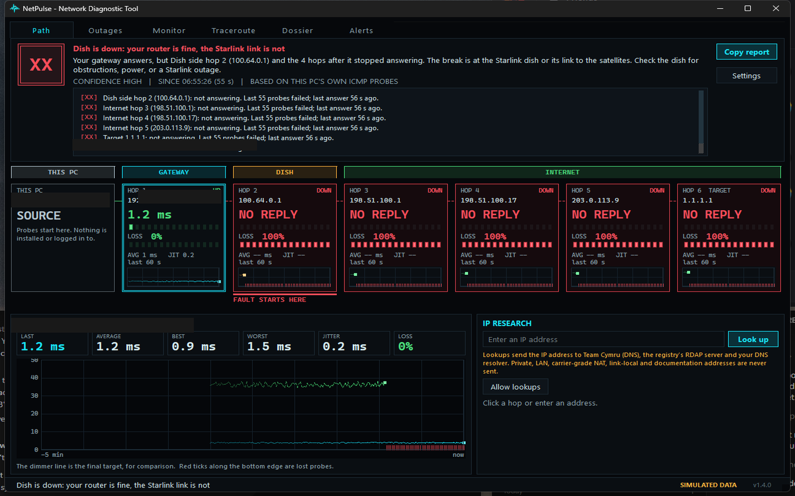
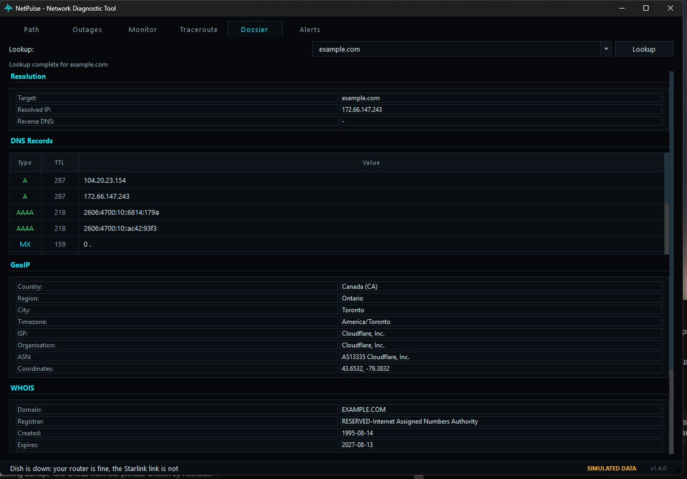
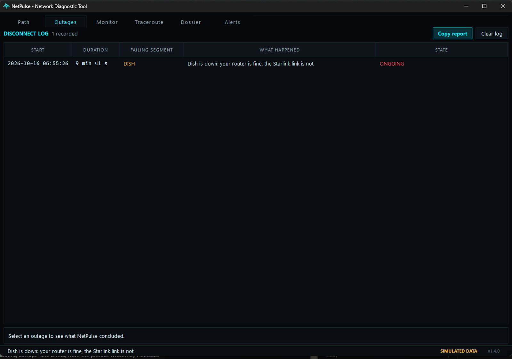

# NetPulse

Windows tray tool that tells you which hop is breaking your connection — instantly, in plain English.



When your internet goes down, you can't tell whether it's your router, your dish, your ISP, or the destination. NetPulse probes every hop on the path to a stable target continuously and surfaces a plain-English verdict with the evidence — no guessing, no manual traceroutes.

## What it does

- **Path map** — a row of instrument cells, one per hop, with live latency, loss, jitter and a 60-second phosphor trace
- **Verdict** — plain-English diagnosis above the map ("Dish is down: your router is fine, the Starlink link is not") with the evidence listed below it; says "Can't tell" instead of guessing when data is thin
- **Outage log** — every disconnect is stored in a local SQLite database with start time, duration and failing segment; survives restarts
- **Copy report** — one click puts a plain-text summary on the clipboard for support calls
- **Dossier** — click any hop or type a domain/IP to see ASN, owner, country, reverse DNS and WHOIS; uses only free, key-less sources
- **Classic tools** — ping monitor, traceroute, alerts (latency/loss/jitter rules with tray notifications)
- **Runs unprivileged** — uses the Windows ICMP API directly; no admin rights, no raw sockets, no router login

## Quick start
Dish detection: CGNAT addresses (100.64.0.0/10), the dish at `192.168.100.1` when reachable, and hops whose owner is Starlink (AS14593, only after you allow lookups).

### Tray

Right-click the tray icon for the current status, **Copy report**, **Start with Windows**, **Add to Start menu**, **Settings...**, **About** and **Exit**. Closing the window keeps NetPulse running in the tray; **Exit NetPulse** quits it completely. `NetPulse.exe --background` starts hidden in the tray (this is what **Start with Windows** registers).

### Where data lives

`%LOCALAPPDATA%\NetPulse\` holds `netpulse.db` (outage log and lookup cache) and `settings.json`. The older ping/dossier history stays in `%APPDATA%\NetPulse\history.json`. Nothing is written to the program folder.

## Classic tools

- **Monitor** - ICMP ping sessions with response times and packet loss, per-process connection watching
  (the ping Interval, Timeout and Graph length for new sessions are in **Settings**, the gear icon at the top right of every tab; next to it are the **Export CSV** and **Share screenshot** icons)
- **Traceroute** - multi-hop path analysis to any host
- **Dossier** - DNS, GeoIP and WHOIS for a domain or IP
- **Alerts** - configurable latency, loss and jitter rules with tray notifications

## Run from source

```bash
pip install -r requirements.txt
python main.py
```

Python 3.10 or later on Windows. The tray icon appears in the system tray; right-click it for the menu.

To try the full UI without touching your real network:

```bash
python main.py --simulate dish-outage
```

Other scenarios: `healthy`, `gateway-outage`, `internet-outage`, `cant-tell`, `loss`, `latency`.

## Screenshots



*The Dossier tab — click any hop or type a domain to look up ASN, WHOIS and GeoIP without leaving the app.*



*The Disconnect Log — every outage is stored locally with start time, duration and which segment failed.*

## Build the executable

```bash
build.bat
```

Wraps PyInstaller with `NetPulse.spec` and writes `%TEMP%\NetPulse-dist\NetPulse\NetPulse.exe`.

## Tests

```bash
python -m pytest
```

## License

[GPL-3.0](LICENSE)

## Feedback

Questions, ideas and bug reports are welcome in [Issues](https://github.com/kilrkrow/netpulse/issues).

---

Built by Guy Schamp · [Fox & Dove](https://foxanddoveconsulting.com) · more tools at [github.com/kilrkrow](https://github.com/kilrkrow)
